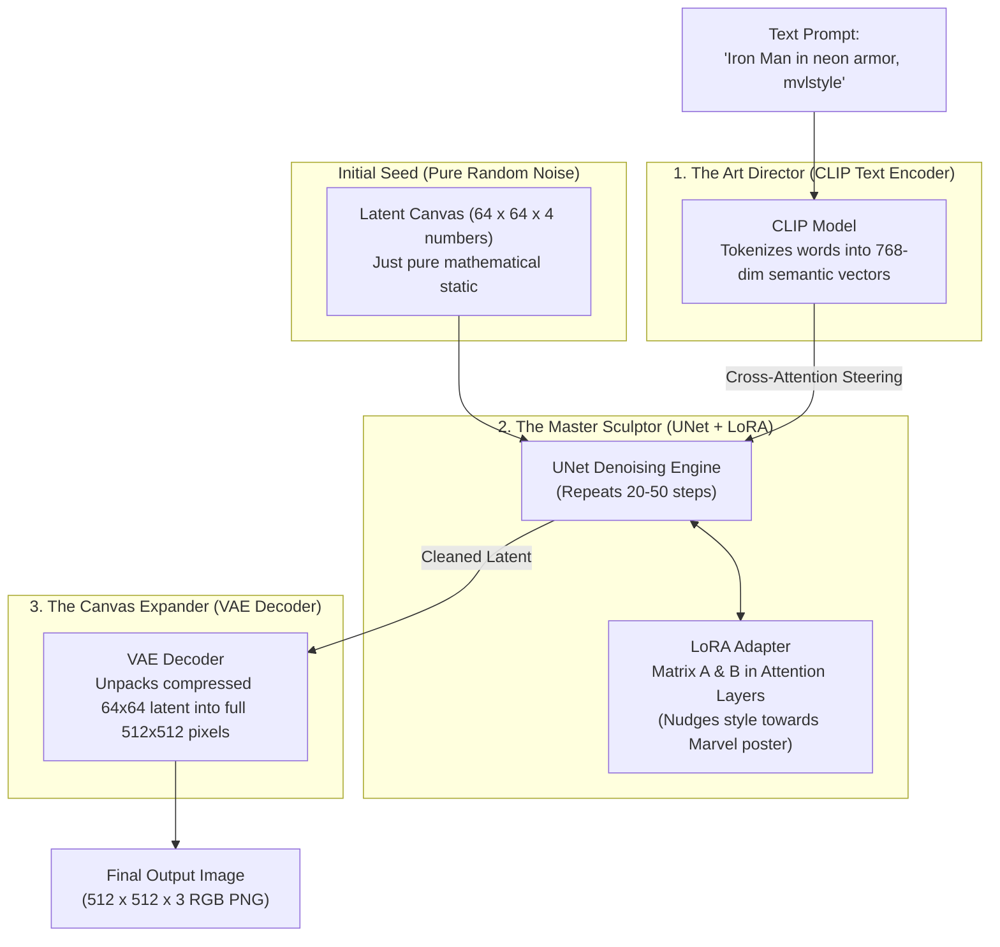
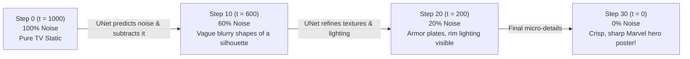

# Diffusion Models vs. LLMs: The Intuitive, Jargon-Free Guide

A comprehensive, plain-English reference manual explaining what diffusion models are, how they generate images, how they fundamentally differ from Large Language Models (like ChatGPT and Claude), and how LoRA adapts them.

Every concept in this guide is paired with real-world analogies, comparison tables, and visual Mermaid diagrams.

---

## Table of Contents

1. [**Visual Overview: The Diffusion Architecture**](#visual-overview)
   - [Diagram 1: The Stable Diffusion Pipeline (The 3 Brains)](#diagram-1)
   - [Diagram 2: The Denoising Process (Sculpting from Pure Static)](#diagram-2)
2. [**What the Hell is a Diffusion Model?**](#what-is-diffusion)
   - [The Drop of Ink Analogy (Physics to AI)](#drop-of-ink)
   - [Forward Diffusion: The Controlled Destruction](#forward-diffusion)
   - [Reverse Diffusion: The Miraculous Restoration](#reverse-diffusion)
   - [The Sculptor in the Fog Analogy](#sculptor-analogy)
3. [**Diffusion Models vs. LLMs: Head-to-Head Comparison**](#diffusion-vs-llms)
   - [Fundamental Architecture Differences](#architecture-differences)
   - [1D Sequential Tokens vs. 2D Continuous Canvases](#tokens-vs-canvases)
   - [Autoregressive Next-Word Prediction vs. Iterative Canvas Denoising](#autoregressive-vs-iterative)
   - [Comprehensive Comparison Matrix](#comparison-matrix)
4. [**What Are Diffusion Models Good and Bad At?**](#good-and-bad)
   - [Superpowers (What They Excel At)](#superpowers)
   - [Kryptonite (Why Hands Have 7 Fingers and Text Looks Like Alien Script)](#kryptonite)
5. [**The 3 Brains of Stable Diffusion (Why Latents Matter)**](#three-brains)
   - [Brain 1: The VAE (The Compression Packer)](#brain-1-vae)
   - [Brain 2: The CLIP Text Encoder (The Art Director)](#brain-2-clip)
   - [Brain 3: The UNet (The Master Sculptor)](#brain-3-unet)
   - [Why Pixel Space is Suicide: The 48x Latent Trick](#latent-trick)
6. [**How Words Steer Pixels: Cross-Attention & CFG**](#steering-pixels)
   - [Cross-Attention: The Telephone Wire Between CLIP and UNet](#cross-attention)
   - [CFG Scale (Classifier-Free Guidance): The Obedience Knob](#cfg-scale)
   - [Negative Prompts: The "Whatever You Do, Don't Draw..." Filter](#negative-prompts)
7. [**How LoRA Attaches to a Diffusion Model**](#diffusion-lora)
   - [Where Do the Matrices Go? (Targeting Cross-Attention)](#targeting-cross-attention)
   - [Why Style LoRAs Work So Well (The Marvel / Superhero Case)](#style-lora)
   - [Why Training a Diffusion LoRA on 6GB VRAM is Possible](#training-on-6gb)
8. [**Master Diffusion Jargon Glossary**](#glossary)

---

## <a id="visual-overview"></a>1. Visual Overview: The Diffusion Architecture

### <a id="diagram-1"></a>Diagram 1: The Stable Diffusion Pipeline (The 3 Brains)



---

### <a id="diagram-2"></a>Diagram 2: The Denoising Process (Sculpting from Pure Static)



---

## <a id="what-is-diffusion"></a>2. What the Hell is a Diffusion Model?

### <a id="drop-of-ink"></a>The Drop of Ink Analogy (Physics to AI)
In physics and chemistry, **diffusion** is when particles naturally spread out from high concentration to low concentration. 
* Imagine dropping a single drop of dark blue ink into a glass of pure water.
* At second 1, you see a sharp, clear droplet.
* At second 10, it swirls and disperses.
* At minute 5, the ink has diffused completely. The entire glass is a uniform, murky light-blue haze.
* **Physics Law:** It is ridiculously easy to turn a clean drop of ink into uniform haze. But it is physically impossible to reverse time and force those billions of dispersed molecules back into a single droplet.

**Diffusion Models are the artificial intelligence that learned how to reverse that law of physics.**

---

### <a id="forward-diffusion"></a>Forward Diffusion: The Controlled Destruction
During the training phase, scientists take millions of beautiful, clean images (cats, superhero posters, mountains) and destroy them on purpose:
1. At Step $t = 0$: Clean image.
2. At Step $t = 1$: Add a tiny pinch of Gaussian noise (digital TV static).
3. At Step $t = 500$: Add more static (the image looks like a heavily distorted television channel).
4. At Step $t = 1000$: Add so much static that **100% of the original picture is obliterated**. It is mathematically indistinguishable from random white noise.

This forward process requires **zero machine learning**—it is just adding random numbers using a fixed mathematical formula.

---

### <a id="reverse-diffusion"></a>Reverse Diffusion: The Miraculous Restoration
Here is where machine learning happens:
We take a neural network (called the **UNet**) and train it on one specific job:
> *"Here is an image at step $t=342$ with some noise on it. Guess what noise was added, so we can subtract it and make the image slightly cleaner."*

By repeating this subtraction 20 to 50 times in a row, the network can start from **complete, random static** (which you could generate by rolling dice) and slowly carve away the static until a breathtaking, photorealistic image emerges.

---

### <a id="sculptor-analogy"></a>The Sculptor in the Fog Analogy
* **Traditional digital graphics (Photoshop / 3D Engines):** Works like an architect drawing blueprints line-by-line, placing polygons and coloring them in.
* **A Diffusion Model:** Works like a master sculptor looking at a raw, rough block of gray marble. 
  - To untrained eyes, the marble block is just formless rock (random noise).
  - But the sculptor has a concept in mind (*"Iron Man in armor"*).
  - Step 1: Chisel off the giant chunks of rock until a human silhouette appears.
  - Step 2: Chisel off medium flakes until the chest plate and helmet appear.
  - Step 3: Polish the surface until fine scratches and reflections shine.
  - Finished: The statue was inside the marble all along; the sculptor simply subtracted the excess rock!

---

## <a id="diffusion-vs-llms"></a>3. Diffusion Models vs. LLMs: Head-to-Head Comparison

People often lump all "Generative AI" into one basket, but **LLMs and Diffusion models are completely different species of neural networks**.

### <a id="architecture-differences"></a>Fundamental Architecture Differences

```
┌────────────────────────────────────────────────────────────────────────┐
│ LARGE LANGUAGE MODEL (e.g. ChatGPT, Claude, SmolLM2)                   │
├────────────────────────────────────────────────────────────────────────┤
│ • Structure: Transformer Decoder (Causal Self-Attention)               │
│ • Input: 1D sequence of text tokens: ["The", "cat", "sat"]             │
│ • Method: Autoregressive Next-Token Guessing                           │
│ • Generation: One word at a time, left-to-right                        │
│ • Coordinates: Discrete integers (Token IDs in a vocabulary)           │
└────────────────────────────────────────────────────────────────────────┘

┌────────────────────────────────────────────────────────────────────────┐
│ DIFFUSION MODEL (e.g. Stable Diffusion, Midjourney, FLUX)              │
├────────────────────────────────────────────────────────────────────────┤
│ • Structure: UNet / DiT (Diffusion Transformer) with Cross-Attention   │
│ • Input: 2D continuous grid of noisy spatial values + Text prompt      │
│ • Method: Iterative Denoising (Score-based Matching)                   │
│ • Generation: Entire canvas refined at once across time-steps          │
│ • Coordinates: Continuous floating-point pixels/latents                │
└────────────────────────────────────────────────────────────────────────┘
```

---

### <a id="tokens-vs-canvases"></a>1D Sequential Tokens vs. 2D Continuous Canvases

1. **How LLMs see the world (1D Chain):**
   * Language is an ordered chain. Word #5 cannot exist without Word #1, #2, #3, and #4 coming before it.
   * If you ask an LLM to generate a paragraph, it calculates:
     $$P(\text{Token}_{n} \mid \text{Token}_1, \dots, \text{Token}_{n-1})$$
   * It never sees the end of the sentence while writing the beginning.

2. **How Diffusion Models see the world (2D Global Space):**
   * An image is not a chain of words; it is a **holistic 2D canvas**.
   * A light source in the top-right corner instantly dictates where shadows fall on an object in the bottom-left corner!
   * Diffusion models don't start at the top-left pixel and print downward like an inkjet printer. They hold the **entire canvas in memory simultaneously**, refining global composition, perspective, and lighting all at once.

---

### <a id="autoregressive-vs-iterative"></a>Autoregressive Next-Word Prediction vs. Iterative Canvas Denoising

* **LLM Generation (Autoregressive):**
  If generating a 100-word story, the LLM runs 100 forward passes. Pass 1 produces word 1. Pass 2 produces word 2... Pass 100 produces word 100. Once a word is printed, it is locked in stone; the model cannot go back and rewrite word 3.
* **Diffusion Generation (Iterative Refinement):**
  If generating a picture with 30 steps, the model looks at **all 262,144 pixels** on Step 1, makes them 3% cleaner. On Step 2, it looks at all pixels again, making them 3% cleaner. It can continuously fix and harmonize the composition throughout the entire generation process.

---

### <a id="comparison-matrix"></a>Comprehensive Comparison Matrix

| Property | Large Language Models (LLMs) | Diffusion Image Models |
| :--- | :--- | :--- |
| **Primary Examples** | GPT-4, Claude 3.5, LLaMA-3, SmolLM2 | Stable Diffusion 1.5/XL, Midjourney, FLUX |
| **Data Modality** | 1D Discrete Text Tokens | 2D Continuous Latent/Pixel Tensors |
| **Generation Style** | Left-to-right, one token at a time | Whole-image refinement over $N$ timesteps |
| **Can it Edit Past Work?** | No (cannot un-say a previous word) | Yes (denoises the whole canvas repeatedly) |
| **Primary Math Engine** | Softmax next-token probability | Noise prediction (Mean Squared Error on noise) |
| **What it Learns** | World knowledge, logic, language, code | Lighting, perspective, textures, geometry, art |
| **Evaluation Metric** | Cross-Entropy Loss / Perplexity | Fréchet Inception Distance (FID) / CLIP Score |
| **Adapter Role (LoRA)** | Changes grammar, persona, tone, vocabulary | Changes art style, lighting, character faces, outfits |

---

## <a id="good-and-bad"></a>4. What Are Diffusion Models Good and Bad At?

Understanding their strengths and flaws is essential so you don't waste time trying to make a model do something it mathematically cannot do.

### <a id="superpowers"></a>Superpowers (What They Excel At)
1. **Photorealism & Lighting:** 
   They understand photons, subsurface skin scattering, volumetric smoke, cinematic lens bokeh, and rim lighting better than 3D graphics rendering engines.
2. **Style Transfer & Fusion:** 
   Combining two wildly unrelated concepts seamlessly (e.g., *"a teapot designed in the aesthetic of a Cyberpunk sports car"*).
3. **Texture Synthesis:** 
   Fur, rusted metal, wet asphalt, leather armor, and neon reflections are rendered with lifelike fidelity.
4. **Compositional Drama:** 
   Wide-angle cinematic lenses, dramatic Dutch tilts, and atmospheric perspective.

---

### <a id="kryptonite"></a>Kryptonite (Why Hands Have 7 Fingers and Text Looks Like Alien Script)

If you've ever used Stable Diffusion or Midjourney, you've seen the horrors: mutated hands with 6 fingers, arms fusing into torsos, and text that looks like ancient Babylonian runes. **Why does this happen?**

#### 1. Why They Struggle With Hands and Anatomy (The 3D Object Problem)
* **The Root Cause:** A diffusion model has **no 3D concept of skeletal anatomy**. It has never seen a skeleton; it has only seen millions of 2D flat photographs.
* When a human makes a fist, points a finger, or holds a sword, fingers occlude (hide behind) each other in 2D space. 
* To the model, a hand in the training data is sometimes 5 visible fingers, sometimes 3 visible fingers (thumb tucked), sometimes 2 (peace sign), and sometimes 4 (side profile).
* Because the model operates on statistical likelihood rather than physical bone mechanics, it averages them together and happily renders 6 or 7 fingers!

#### 2. Why They Cannot Spell Words (The No-Tokenizer Problem)
* When you tell an LLM to write `"MARVEL"`, the LLM has a discrete tokenizer that knows the exact letter sequence `M-A-R-V-E-L`.
* An image diffusion model does **not** see letters as words; it sees them as **textures and shapes of lines**.
* To a diffusion model, the word `"COFFEE"` on a storefront sign is just a decorative squiggly black pattern on a white rectangle. It doesn't know spelling exists; it only knows that coffee shop signs tend to have horizontal clusters of glyph-like curves.

#### 3. Counting & Relational Logic
* Prompt: *"Three red apples on the left, two green apples on the right."*
* A diffusion model will almost certainly give you 4 or 5 mixed red and green apples scattered randomly.
* Diffusion models struggle with counting because attention maps bleed into each other during the early noisy steps.

---

## <a id="three-brains"></a>5. The 3 Brains of Stable Diffusion (Why Latents Matter)

Stable Diffusion is not one giant neural network. It is an ensemble pipeline of **three completely distinct models working together**:

```
                       ┌──────────────────────────────────────────────┐
                       │           THE STABLE DIFFUSION PIPELINE      │
                       └──────────────────────────────────────────────┘
                                              │
         ┌────────────────────────────────────┼────────────────────────────────────┐
         │                                    │                                    │
         ▼                                    ▼                                    ▼
┌──────────────────┐               ┌──────────────────────┐             ┌─────────────────────┐
│ 1. CLIP TEXT     │               │ 2. THE UNET          │             │ 3. THE VAE          │
│    ENCODER       │               │    (THE BRAIN)       │             │    (THE PACKER)     │
├──────────────────┤               ├──────────────────────┤             ├─────────────────────┤
│ Role: Director   │               │ Role: Sculptor       │             │ Role: Translator    │
│ Input: Prompt    │               │ Input: Noise + CLIP  │             │ Input: Latents      │
│ Output: 77x768   │               │ Output: Pure Latent  │             │ Output: Full RGB    │
│ semantic vectors │               │ denoised step-by-step│             │ 512x512 pixels      │
└──────────────────┘               └──────────────────────┘             └─────────────────────┘
```

---

### <a id="brain-1-vae"></a>Brain 1: The VAE (The Compression Packer)
* **Full Name:** Variational Autoencoder.
* **Role:** The Translator between the human visual world (pixels) and the mathematical realm (latents).
* **The Encoder ($E$):** Takes a $512 \times 512 \times 3$ RGB image and compresses it into a $64 \times 64 \times 4$ latent grid.
* **The Decoder ($D$):** Takes the final clean $64 \times 64 \times 4$ latent grid and inflates it back into full-resolution $512 \times 512 \times 3$ pixels that you can save as a `.png`.

---

### <a id="brain-2-clip"></a>Brain 2: The CLIP Text Encoder (The Art Director)
* **Created by:** OpenAI in 2021 (Contrastive Language-Image Pre-training).
* **Role:** Translates human language into a mathematical coordinate space that connects words to visual concepts.
* It knows that the word `"neon"` should map to high-luminance blues and pinks.
* It knows that `"rain"` maps to vertical streaks and wet reflective ground.
* It outputs a matrix of shape `[77, 768]` representing the meaning of your prompt.

---

### <a id="brain-3-unet"></a>Brain 3: The UNet (The Master Sculptor)
* **Role:** This is the core diffusion model (860 Million parameters in SD 1.5).
* It takes the noisy latent canvas and the CLIP text embeddings, and its sole task is to predict:
  > *"What noise is contaminating this latent right now?"*
* It uses **Cross-Attention layers** to let the CLIP text instructions whisper into the visual feature maps at every stage of downsampling and upsampling.

---

### <a id="latent-trick"></a>Why Pixel Space is Suicide: The 48x Latent Trick

Before Stable Diffusion (in early models like DDPM in 2020), diffusion was performed directly on raw pixels.
* A $512 \times 512$ color image has:
  $$512 \times 512 \times 3\text{ (RGB colors)} = \mathbf{786{,}432\text{ individual numbers to calculate!}}$$
* Running a 50-step diffusion process on 786,432 numbers required supercomputers with 40GB to 80GB VRAM. It was impossible to run on consumer laptops.

**The Latent Diffusion Breakthrough (Rombach et al., 2022):**
The researchers realized that most pixels in an image are redundant (if pixel [100, 100] is sky blue, pixel [100, 101] is almost certainly sky blue too).
* By running the image through the **VAE**, they shrank the canvas from $512 \times 512 \times 3$ down to $64 \times 64 \times 4$.
* Total numbers in latent space:
  $$64 \times 64 \times 4 = \mathbf{16{,}384\text{ numbers}}$$

$$\frac{786{,}432\text{ raw pixels}}{16{,}384\text{ latent coordinates}} = \mathbf{48\times\text{ Compression!}}$$

By running diffusion inside this compact 48x smaller latent space, **memory requirements dropped by 95%**, allowing Stable Diffusion to run on ordinary consumer graphics cards with 4GB to 8GB of VRAM!

---

## <a id="steering-pixels"></a>6. How Words Steer Pixels: Cross-Attention & CFG

### <a id="cross-attention"></a>Cross-Attention: The Telephone Wire Between CLIP and UNet

How does typing `"glowing armor"` actually force the static to form armor?

Inside the UNet are **Cross-Attention blocks**:
1. **Query ($Q$):** Comes from the **noisy visual pixels** in the UNet (*"What shape am I currently forming here?"*).
2. **Key ($K$):** Comes from the **CLIP text vectors** (*"The user asked for armor, neon lighting, and rain"*).
3. **Value ($V$):** The actual feature instructions to inject.

When calculating attention:
$$\text{Attention}(Q, K, V) = \text{softmax}\left(\frac{Q K^T}{\sqrt{d_k}}\right) V$$

The pixel features calculate similarity against the word features. If a patch of noisy pixels looks vaguely like a human torso, the attention mechanism matches it with the text token `"armor"` and injects armor patterns into that region of the canvas!

---

### <a id="cfg-scale"></a>CFG Scale (Classifier-Free Guidance): The Obedience Knob

When generating images, you always see a slider named **CFG Scale** (usually defaulted to `7.0` or `7.5`). **What does it do?**

In reality, on every single step, Stable Diffusion actually runs the UNet **twice**:
1. Run 1: Predicts noise **with** your text prompt ($N_{\text{text}}$).
2. Run 2: Predicts noise **without** any prompt (blank text) ($N_{\text{uncond}}$).

Then it applies this formula:
$$\text{Final Noise} = N_{\text{uncond}} + \text{CFG} \times (N_{\text{text}} - N_{\text{uncond}})$$

#### What the values mean:
* **CFG = 1.0 (Zero Guidance):** The model ignores your prompt. It generates whatever random pretty picture it feels like.
* **CFG = 7.0 to 8.0 (The Sweet Spot):** The model strikes a perfect balance between creative aesthetics and faithfully following your prompt.
* **CFG = 15.0 to 30.0 (Overcooked / Deep-Fried):** The model is forced to obey your prompt with extreme aggression. Colors become violently oversaturated, contrasts blow out, and grotesque artifacts appear.

---

### <a id="negative-prompts"></a>Negative Prompts: The "Whatever You Do, Don't Draw..." Filter

In LLMs, you can't easily tell a model *"don't think of an elephant"* without it accidentally thinking of an elephant. 

In Diffusion, negative prompting is mathematically trivial!
Remember Run 2 from the CFG formula above?
Instead of leaving the unconditioned run blank, we feed your **Negative Prompt** into Run 2!
$$\text{Final Noise} = N_{\text{negative}} + \text{CFG} \times (N_{\text{positive}} - N_{\text{negative}})$$

The math literally subtracts the direction of the negative prompt from the image!
* If you put `"blurry, extra fingers, cartoon"` in the negative prompt, the model calculates the visual gradient toward blurriness and moves in the exact **opposite direction**!

---

## <a id="diffusion-lora"></a>7. How LoRA Attaches to a Diffusion Model

Just like we attached LoRA to the attention layers ($W_q, W_v$) of our language model, we can attach LoRA to a diffusion model!

### <a id="targeting-cross-attention"></a>Where Do the Matrices Go? (Targeting Cross-Attention)
Inside the UNet, there are attention layers that cross-reference the image pixels with the CLIP text tokens:
* `to_q` (Query projection)
* `to_k` (Key projection)
* `to_v` (Value projection)
* `to_out.0` (Output projection)

When we train a Diffusion LoRA:
1. We **freeze 100% of the base UNet** (all 860M weights).
2. We inject small Matrix $A$ and Matrix $B$ pairs alongside those cross-attention projections:
   $$W_{\text{new}} = W_{\text{base}} + \frac{\alpha}{r}(B \cdot A)$$

---

### <a id="style-lora"></a>Why Style LoRAs Work So Well (The Marvel / Superhero Case)

When we train our **Marvel Poster LoRA**:
* We show the model 15 to 20 images of dramatic superhero posters captioned with a unique trigger word:
  > `"mvlstyle poster of an armored hero, dramatic rim lighting, cinematic background"`
* The base model already knows what a man, armor, and helmets look like.
* **Matrix $A$ and $B$ only have to learn one thing:** 
  Whenever the token `"mvlstyle"` appears in the prompt, steer the cross-attention layers toward:
  - High-contrast edge highlights (cyan/orange rim lights).
  - Low-angle heroic perspective.
  - Moody cinematic smoke and vignette borders.

Because it only has to learn that stylistic steering direction, an adapter with **rank $r = 4$ or $r = 8$** (only 3 to 6 megabytes!) is enough to capture the entire Marvel cinematic aesthetic!

---

### <a id="training-on-6gb"></a>Why Training a Diffusion LoRA on 6GB VRAM is Possible

If you tried to train all of Stable Diffusion, you would need 16GB+ VRAM. But on our **6GB RTX 3050 Laptop GPU**, we can train a LoRA cleanly because:

1. **Frozen Base Weights:** The 860M UNet weights require **zero optimizer memory** (no momentum, no variance buffers).
2. **Pre-Caching Latents (The Huge Secret):**
   - The VAE takes ~1.5 GB of VRAM.
   - The CLIP text encoder takes ~1.0 GB of VRAM.
   - **Before training starts, we run our 15 training images through the VAE and CLIP once on CPU/RAM, and save those compact numbers to disk.**
   - During actual training, **we throw VAE and CLIP completely out of GPU memory!**
3. **Only the UNet in VRAM:**
   - In 16-bit half precision (FP16), the UNet takes only **~1.7 GB of VRAM**.
   - With LoRA rank $r=4$, the trainable parameters are only **~3 MB**.
   - Total peak VRAM during training: **~3.2 to 3.8 GB**, leaving over 2 GB of headroom on your 6GB card!

---

## <a id="glossary"></a>8. Master Diffusion Jargon Glossary

| Term | Plain English Meaning |
| :--- | :--- |
| **Diffusion** | The process of gradually adding noise to destroy data, and learning to reverse it to create data. |
| **UNet** | The primary neural network engine in Stable Diffusion that predicts and subtracts noise. |
| **VAE** | Variational Autoencoder; compresses $512 \times 512$ pixels into $64 \times 64$ latents (48x smaller). |
| **Latent Space** | The mathematical playground where diffusion happens; much smaller and faster than pixel space. |
| **CLIP** | OpenAI's text encoder that converts your prompt into 768-dimensional visual-semantic concept vectors. |
| **Cross-Attention** | The mathematical bridge inside the UNet where CLIP text vectors whisper instructions to noisy pixels. |
| **Timestep ($t$)** | A scale from $1000$ (pure white noise) down to $0$ (crystal-clear finished image). |
| **CFG Scale** | Classifier-Free Guidance; a volume knob controlling how strictly the model must obey your prompt. |
| **Negative Prompt** | A mathematical anti-direction; features the model actively steers away from during denoising. |
| **Scheduler / Sampler** | The mathematical algorithm (e.g. Euler-A, DDIM) that calculates the step size when stepping from $t=1000$ to $0$. |
| **Trigger Word** | A unique word (e.g. `mvlstyle`) associated with your LoRA to activate its trained style on command. |
| **Noise Prediction** | What the UNet actually outputs; it doesn't output an image, it outputs a map of the noise to subtract. |

