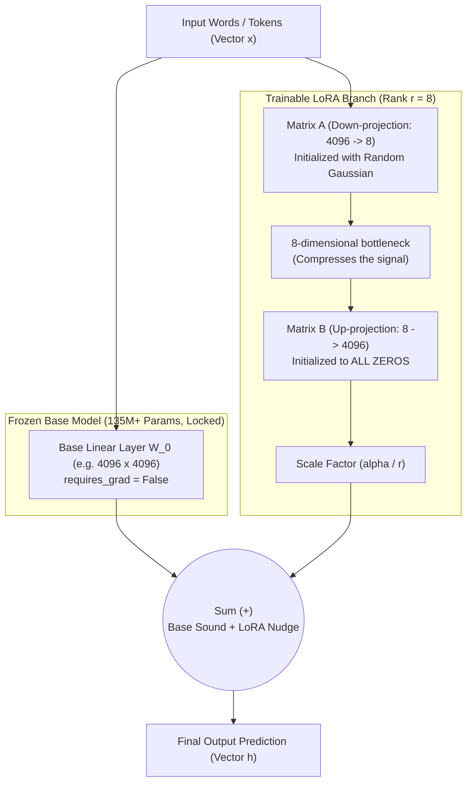
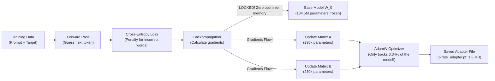
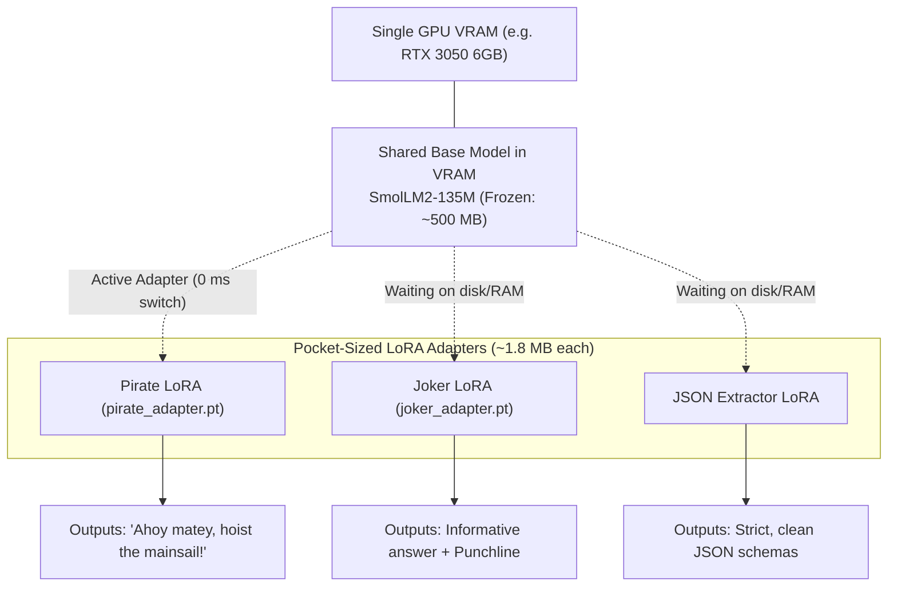
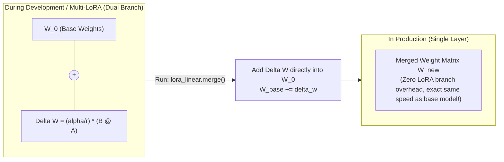

# Machine Learning & LoRA: The Intuitive, Jargon-Free Guide

A comprehensive, plain-English reference manual for understanding Deep Learning, Linear Algebra for AI, and Low-Rank Adaptation (LoRA).

Every technical term in this guide is paired with a real-world analogy, concrete examples, and visual Mermaid diagrams.

---

## Table of Contents

1. [**Visual Guide: The 4 Diagrams of LoRA**](#visual-guide)
   - [Diagram 1: The LoRA Architecture (Forward Pass)](#diagram-1)
   - [Diagram 2: How a LoRA is Trained (Gradient Freezing)](#diagram-2)
   - [Diagram 3: Multi-LoRA Hot-Swapping (The Real-World Superpower)](#diagram-3)
   - [Diagram 4: Zero-Latency Weight Merging (Deployment)](#diagram-4)
2. [**Core AI & LLM Mechanics (The Factory Floor)**](#core-ai)
   - [Parameters & Weights (The Soundboard Dials)](#parameters-weights)
   - [Pre-Training vs. Fine-Tuning (School vs. Hospital Orientation)](#pretraining-vs-finetuning)
   - [Forward Pass, Loss, and Gradients (Assembly Line & Foggy Mountain)](#forward-loss-gradients)
   - [Why AdamW Optimizer Eats Your GPU Memory (Momentum & Variance Ledger)](#adamw-memory)
   - [Freezing Weights (Locking the Dials)](#freezing-weights)
3. [**Linear Algebra in Plain English**](#linear-algebra)
   - [High Dimensions & Embeddings (The Trait Checklist)](#embeddings)
   - [Row vs. Column Vectors in PyTorch ($y = x W^T$)](#row-vs-column)
   - [Linear Combinations & Independence (The Primary Colors Rule)](#linear-combinations)
   - [Matrix Rank (True Degrees of Freedom)](#matrix-rank)
   - [Subspaces (A Sheet of Paper in a Living Room)](#subspaces)
4. [**LoRA (Low-Rank Adaptation) Unpacked**](#lora-unpacked)
   - [The Core Problem: Full Fine-Tuning is Too Heavy](#core-problem)
   - [Where LoRA Sits: Parallel Side-Track vs. Top-Layer Wrapper](#where-lora-sits)
   - [The Hourglass Configuration ($d \to r \to d$): Why This Exact Shape?](#why-hourglass-config)
   - [The Intrinsic Rank Hypothesis (Car Steering Analogy)](#intrinsic-rank)
   - [How is Rank ($r$) Determined? (Calculation vs. Hyperparameter)](#how-rank-is-chosen)
   - [The Matrix Factorization Trick ($\Delta W = B \cdot A$)](#factorization)
   - [The Initialization Trick (Why A is Random and B is Zero)](#initialization-trick)
   - [The Scaling Factor ($\alpha / r$)](#scaling-factor)
5. [**The Transformer Brain: Why Target Attention?**](#transformer-attention)
   - [The Library Analogy for Attention (Query, Key, Value)](#library-analogy)
   - [Why LoRA Targets $W_q$ and $W_v$](#why-target-wq-wv)
6. [**The Grand Piano Analogy (The Complete Mental Model)**](#grand-piano)
7. [**Hardware, Files, and Byte Math**](#hardware-and-files)
   - [What is Inside a `.pt` File?](#inside-pt-file)
   - [Napkin Math: Why Our Adapter Was Exactly 1.8 MB](#napkin-math)
   - [Model Incompatibility: The Paris vs. Tokyo GPS Problem](#model-incompatibility)
   - [Quantization & QLoRA: Measuring with a Coarser Ruler](#quantization-qlora)
8. [**Real-World Lessons: Style vs. Reasoning**](#lessons-learned)
   - [Why Pirate Worked, but Jokes Made No Sense](#pirate-vs-joker)
   - [Cargo Cult AI](#cargo-cult)
   - [The LIMA Principle (Quality Over Quantity)](#lima-principle)
9. [**Master Jargon Glossary**](#glossary)

---

## <a id="visual-guide"></a>1. Visual Guide: The 4 Diagrams of LoRA

### <a id="diagram-1"></a>Diagram 1: The LoRA Architecture (How it Works in the Forward Pass)



---

### <a id="diagram-2"></a>Diagram 2: How a LoRA is Trained (The Training Loop & Gradient Freezing)



---

### <a id="diagram-3"></a>Diagram 3: Multi-LoRA Hot-Swapping (The Real-World Superpower)



---

### <a id="diagram-4"></a>Diagram 4: Zero-Latency Weight Merging (Deployment)



---

## <a id="core-ai"></a>2. Core AI & LLM Mechanics (The Factory Floor)

### <a id="parameters-weights"></a>Parameters & Weights
* **Formal Definition:** Numerical values in a neural network that multiply inputs to calculate outputs.
* **Plain English:** A parameter is literally just a decimal number (like `0.042` or `-1.218`).
* **The Soundboard Analogy:** Imagine an audio mixing board with **135 million individual slider knobs**. Pre-training is the process of spending millions of dollars adjusting all 135 million knobs until music sounds clear instead of static.

---

### <a id="pretraining-vs-finetuning"></a>Pre-Training vs. Fine-Tuning
* **Pre-Training (General Knowledge):** 
  Teaching a raw, random model how human language, grammar, history, and coding work by feeding it trillions of words from the public internet. 
  * *Analogy:* Someone going to school from Kindergarten through University to earn a broad degree.
* **Fine-Tuning (Specialization):** 
  Taking an already-educated base model and training it on a specific narrow dataset (like speaking like a pirate or formatting text into JSON).
  * *Analogy:* A graduated doctor doing a 2-day workshop to learn the computer filing system at a specific hospital.

---

### <a id="forward-loss-gradients"></a>Forward Pass, Loss, and Gradients

1. **The Forward Pass (The Factory Assembly Line):**
   Input words enter the network, get converted into numbers, and pass forward through layer after layer of matrix multiplications until the model outputs a predicted next word.
2. **The Loss (The Penalty Box):**
   A mathematical measurement of how wrong the model was.
   * If the correct next word was `"Ahoy"` and the model was 99% confident in `"Ahoy"`, the loss is practically **0**.
   * If the model guessed `"Hello"` with 99% confidence, the loss is **huge** (~3.0+). The loss acts like a referee issuing a penalty for bad guesses.
3. **The Gradient (The Foggy Mountain Analogy):**
   * Imagine you are blindfolded on a foggy mountain and your goal is to reach the valley (zero loss/error).
   * You cannot see the bottom, but you can feel the slope of the ground beneath your feet.
   * The **gradient** is that slope! It tells the computer: *"If you nudge dial #452 slightly to the right, you will step downhill toward lower error."*
4. **Learning Rate (Step Size):**
   How big of a step you take downhill. If your step size is too large, you leap right over the valley; if it's too small, it takes months to reach the bottom.

---

### <a id="adamw-memory"></a>Why AdamW Optimizer Eats Your GPU Memory

When you run standard training with the **AdamW optimizer**, it doesn't just store the weights—it stores a historical record for every single dial:

1. **Base Weight:** 4 bytes (the current dial setting).
2. **Gradient:** 4 bytes (the direction to nudge it).
3. **Momentum (Running Average of Gradients):** 4 bytes.
   * *Analogy:* Like rolling a heavy boulder downhill. Even if the ground momentarily flattens out, the momentum keeps it rolling through tiny potholes.
4. **Variance (Historical Bounciness):** 4 bytes.
   * *Analogy:* Keeps track of how bumpy the slope has been so it can automatically slow down on rough patches.

$$\text{Total Memory per Parameter} = 4 + 4 + 4 + 4 = \mathbf{16\text{ bytes}}$$

* For a **7 Billion parameter model**: $7\text{B} \times 16\text{ bytes} \approx \mathbf{112\text{ GB of VRAM}}$!
* This is why full fine-tuning crashes on consumer GPUs like an RTX 3050 (6 GB VRAM).

---

### <a id="freezing-weights"></a>Freezing Weights (`requires_grad = False`)
Freezing tells PyTorch:
> *"Padlock these weights. Do not calculate gradients for them, and do not track momentum or variance for them in the optimizer."*

Frozen weights drop their training memory cost to **zero extra bytes**!

---

## <a id="linear-algebra"></a>3. Linear Algebra in Plain English

### <a id="embeddings"></a>High Dimensions & Embeddings (The Trait Checklist)
When you hear that a model has an embedding size of **$d = 4096$** (or **$576$** in SmolLM2), what does that dimension mean?

* Computers don't understand words; they understand vectors (lists of numbers).
* Imagine describing every word using a checklist of 4,096 traits:
  * Trait 1: *Is it alive?* (`+0.9` for dog, `-0.8` for rock)
  * Trait 2: *Is it royal?* (`+0.95` for king, `-0.7` for plumber)
  * Trait 3: *Is it nautical?* (`+0.99` for pirate, `-0.9` for desert)
* Each word is given coordinates in this **4,096-dimensional trait space**. Similar words naturally end up near each other.

---

### <a id="row-vs-column"></a>Row vs. Column Vectors in PyTorch ($y = x W^T$)
* **College Math:** Formulates vectors as vertical columns:
  $$y = W \cdot x$$
* **PyTorch & CUDA Hardware:** Formulates data as horizontal batches (rows of sentences):
  $$y = x \cdot W^T$$
  *(Where `x` has shape `(batch, in_features)`, `W` has shape `(out_features, in_features)`, and `.T` flips `W` so the inner dimensions line up).*

---

### <a id="linear-combinations"></a>Linear Combinations & Independence (The Primary Colors Rule)
* **Linear Combination:** Taking several vectors, scaling them by numbers, and adding them up:
  $$\text{Result} = (2 \times \mathbf{v_1}) + (-0.5 \times \mathbf{v_2})$$
* **Linear Dependence (Redundant Information):**
  If vector $\mathbf{v_3}$ is simply a mixture of $\mathbf{v_1}$ and $\mathbf{v_2}$, it brings **no new direction** to the table.
* **Linear Independence (Unique Information):**
  A set of vectors where **no single vector can be built from any combination of the others**.

#### The Paint Analogy:
* **Red, Blue, and Yellow** are linearly independent. You cannot mix Red and Yellow to get Blue.
* **Orange, Green, and Purple** are linearly dependent. Orange is just a linear combination of Red and Yellow!

---

### <a id="matrix-rank"></a>Matrix Rank (True Degrees of Freedom)
> **Matrix Rank** is the number of linearly independent rows or columns in a matrix. It tells you the **true number of unique dimensions of information** inside that matrix.

* Suppose you have a giant table with 4,096 rows and 4,096 columns (16.7 million numbers).
* If every row is unique and independent, its rank is **full (4096)**.
* But if **only 4 rows** are independent building blocks, and the other 4,092 rows are just recipes mixed from those 4, the matrix has a **rank of only 4**.

---

### <a id="subspaces"></a>Subspaces (A Sheet of Paper in a Living Room)
* Imagine standing inside a high-ceiling 3D living room ($x, y, z$). You can move in all 3 directions.
* Now place a flat 2D sheet of printer paper on the floor. An ant crawling on that paper can only move forward/backward and left/right. 
* Even though the paper exists inside a 3D room, the ant is trapped in a **2-dimensional subspace**!
* **In LoRA:** Even though our matrices live inside a giant 4096-dimensional space, LoRA traps the weight update inside an **8-dimensional subspace**.

---

## <a id="lora-unpacked"></a>4. LoRA (Low-Rank Adaptation) Unpacked

### <a id="core-problem"></a>The Core Problem: Full Fine-Tuning is Too Heavy
In full fine-tuning, you update the entire weight matrix:
$$W_{\text{new}} = W_0 + \Delta W$$
If $W_0$ is $4096 \times 4096$, then $\Delta W$ is also $4096 \times 4096$ = **16.7 million parameters** that must be tracked by AdamW.

---

### <a id="where-lora-sits"></a>Where LoRA Actually Sits: Parallel Side-Track vs. Top-Layer Wrapper
A common mental trap is imagining LoRA as an outer wrapper sitting *on top* of the LLM (like a cherry on top of a cake or a final spellchecker after the text is generated).

In reality:
* **LoRA sits deep *inside* the model, spliced in parallel alongside individual projection layers** (specifically the Attention projections $W_q$ and $W_v$).
* When an input vector $x$ arrives at an internal layer, the road forks:
  1. **The Highway (Base Model):** $x$ passes through the frozen $W_0$ layer untouched, preserving all general language understanding.
  2. **The Detour (LoRA Branch):** In parallel, an exact copy of $x$ travels through Matrix $A$ and Matrix $B$.
* At the end of the layer, the two roads rejoin at a **Summing Junction (+)**:
  $$\text{Layer Output} = W_0 x + \Delta W x$$
* The base model never even realizes it is being augmented—it simply receives a tiny, learned nudge at each layer!

---

### <a id="why-hourglass-config"></a>The Hourglass Configuration ($d \to r \to d$): Why This Exact Shape?
Why does LoRA compress the vector down to rank $r$ (e.g. 8) and immediately expand it back to the original size (e.g. 576)? Why not leave it compressed, or use a single square matrix?

#### 1. The Plug-in Requirement (The Shape Match)
Inside `SmolLM2-135M`, vectors moving between layers have **576 numbers**.
* Because the LoRA output must be added directly to the base model's output at the $(+)$ junction:
  $$\text{Combined Vector} = \text{Base Vector} (1 \times 576) + \text{LoRA Vector} (1 \times 576)$$
* In linear algebra, **you cannot add lists of different lengths**. You cannot add an 8-number list to a 576-number list. Therefore, whatever happens inside LoRA, the input **must be 576** and the final output **must be 576**.

#### 2. The Bottleneck Trick: Parameter Savings
If we kept it at $576 \times 576$ without a bottleneck:
* Training a single layer = $576 \times 576 = \mathbf{331{,}776}$ parameters.
* With a bottleneck of $r = 8$:
  * **Matrix A ($576 \to 8$):** $576 \times 8 = 4{,}608$ parameters.
  * **Matrix B ($8 \to 576$):** $8 \times 576 = 4{,}608$ parameters.
  * **Total:** $4{,}608 + 4{,}608 = \mathbf{9{,}216}$ parameters!
* That is a **97.2% reduction in trainable parameters** per layer, allowing adapters to fit in pocket-sized files (~1.8 MB).

#### 3. The Executive Assistant Analogy
Think of the $576 \to 8 \to 576$ hourglass as an Executive Assistant translating a memo into Pirate Speak:
* **Input (576 words):** The full, complex business message arrives.
* **Matrix A (The Summarizer):** Condenses the 576 dimensions into **8 core stylistic signals** (e.g., *"Is this a greeting?"*, *"How nautical is the topic?"*, *"What is the excitement level?"*). It ignores general grammar and facts because the base model already knows them.
* **Matrix B (The Broadcaster):** Takes those 8 high-level mood numbers and broadcasts them back out into 576 specific vocabulary adjustments to favor words like *"Ahoy"* and *"Matey"*.

---

### <a id="intrinsic-rank"></a>The Intrinsic Rank Hypothesis (Car Steering Analogy)
In 2021, Microsoft researchers published a breakthrough hypothesis:
> When an LLM learns a new specific task (like pirate speak, coding SQL, or extracting JSON), the update matrix $\Delta W$ does **not** need 4,096 independent degrees of freedom. Its **intrinsic rank** is tiny (often $r = 4$ or $r = 8$).

#### The Car Steering Analogy:
* A modern sports car contains over **30,000 individual mechanical parts** (valves, pistons, brake lines). That is its high-dimensional complexity.
* But when you drive, you don't adjust 30,000 parts individually. You only touch **2 controls**: the steering wheel and the gas pedal!
* The **intrinsic dimension** of driving is just 2!
* LoRA recognizes that adapting an LLM to a specific style only needs a couple of "steering knobs," not 16 million dials.

---

### <a id="how-rank-is-chosen"></a>How is Rank ($r$) Determined? (Calculation vs. Hyperparameter)
A very common question is: *Is rank $r$ calculated by a formula? Does an equation tell you what rank to use?*

**No. Rank $r$ is a hyperparameter**—a human decision chosen by the engineer before training starts, just like setting the temperature on your thermostat.

#### 1. The Microsoft Benchmark Experiment
When Edward Hu and the Microsoft team created LoRA in 2021, they didn't know which rank was optimal either. So they tested different values of $r$ on massive standard benchmarks:

| Rank ($r$) | Relative Size | Task Accuracy |
| :--- | :--- | :--- |
| **$r = 1$** | Extremely tiny | 89.2% |
| **$r = 2$** | Tiny | 90.1% |
| **$r = 4$** | Sweet spot | 90.8% |
| **$r = 8$** | Sweet spot | **91.0% (Near Peak)** |
| **$r = 16$** | 2x larger | 91.1% (Virtually identical) |
| **$r = 64$** | 8x larger | 91.0% (Zero additional gain!) |

**The Discovery:** Increasing the rank from 8 to 64 multiplied the parameter count by 8x, but gave **zero measurable improvement**. The task's "intrinsic rank" was already fully captured at $r = 8$!

#### 2. Practical Rules of Thumb for Choosing $r$
Engineers choose $r$ based on **information density**:
* **$r = 4$ to $8$ (Style, Persona, Tone):** 
  * *Examples:* Pirate speak, Customer service polite tone, Shakespearean English.
  * *Why:* The base model already knows the words; it only needs a few steering signals to adjust its tone.
* **$r = 8$ to $16$ (Structured Formats & Classification):** 
  * *Examples:* Strict JSON outputs, SQL generation, sentiment classification.
  * *Why:* The model needs to track rigid bracket syntax and grammatical rules.
* **$r = 32$ to $64+$ (Deep Domain Knowledge & Heavy Reasoning):** 
  * *Examples:* Medical diagnosis, legal contract interpretation, advanced mathematical reasoning.
  * *Why:* The model must learn complex new conceptual relationships.

#### 3. Why Not Just Pick $r = 256$ "Just to Be Safe"?
* **Overfitting (Memorization vs. Learning):** If $r$ is too high, the adapter has so many free parameters that it simply memorizes your exact training sentences word-for-word rather than learning the general style.
* **VRAM & Training Speed:** Every increase in $r$ inflates optimizer state memory and slows down backpropagation on your GPU.

#### 4. The Mathematical Verification (SVD - Singular Value Decomposition)
If you want mathematical proof after training, you can run **Singular Value Decomposition (SVD)** on the trained $\Delta W = B \cdot A$ matrix:
* SVD measures how much "energy" (variance/importance) is carried by each rank dimension.
* When researchers inspect trained adapters with SVD, they consistently find that the **first 4 to 8 dimensions contain over 95% of the total signal**. The remaining dimensions (9 through 64) are flat, near-zero noise.

---

### <a id="factorization"></a>The Matrix Factorization Trick ($\Delta W = B \cdot A$)
Instead of allocating a massive $4096 \times 4096$ grid for $\Delta W$, LoRA decomposes it into two slim matrices:

$$\Delta W = B \cdot A$$

#### The Math Check for $r = 4$:
* **Matrix A:** Shape $(4 \times 4096) = 16,384$ numbers. (Acts as the **compressor**).
* **Matrix B:** Shape $(4096 \times 4) = 16,384$ numbers. (Acts as the **expander**).
* **Total parameters:** $16,384 + 16,384 = \mathbf{32,768}$ numbers.
* Compared to $16,777,216$ numbers in full fine-tuning, this is a **99.8% parameter reduction**!

---

### <a id="initialization-trick"></a>The Initialization Trick (Why A is Random and B is Zero)
Why didn't the researchers initialize both $A$ and $B$ with random numbers, or both with zeros?

1. **If both were random:**
   At Step 0 of training, $B \times A$ would produce random static noise that would immediately destroy the pre-trained model's brain!
2. **If both were zero:**
   If both are all zeros, the gradient calculation suffers from a mathematical problem called **symmetry**—the network doesn't know which direction to start nudging.
3. **The Elegant Solution:**
   * **Matrix A** is initialized with small random numbers (breaking symmetry).
   * **Matrix B** is initialized to **all zeros**!
   * Since anything multiplied by zero is zero:
     $$\Delta W_{\text{step 0}} = 0 \cdot A = \mathbf{0}$$
   * At step 0, the model acts **100% identically to the pristine base model**. Nothing is corrupted!

---

### <a id="scaling-factor"></a>The Scaling Factor ($\frac{\alpha}{r}$)
In the forward pass formula:
$$h = W_0 x + \frac{\alpha}{r} (B A x)$$
* $\alpha$ (Alpha) is a hyperparameter constant (usually set to $2r$ or $r$, like $\alpha = 16$ for $r = 8$).
* **Why it exists:** If you decide to change your rank from $r = 8$ to $r = 16$, the numbers inside $B \times A$ would naturally double in magnitude. The $\frac{\alpha}{r}$ ratio normalizes the signal so you don't have to re-tune your learning rate every time you test a new rank!

---

## <a id="transformer-attention"></a>5. The Transformer Brain: Why Target Attention?

In transformers (like LLaMA, GPT, or SmolLM2), why do we attach LoRA to $W_q$ and $W_v$?

### <a id="library-analogy"></a>The Library Analogy for Attention (Query, Key, Value)
Attention inside an LLM works like a digital search system:
1. **Query ($W_q$):** *"What am I currently searching for?"* (e.g., the user just asked about pirates).
2. **Key ($W_k$):** The index tags on all known facts in the model's memory.
3. **Value ($W_v$):** The actual information and vocabulary payload retrieved.

### <a id="why-target-wq-wv"></a>Why LoRA Targets $W_q$ and $W_v$
* By attaching LoRA to **$W_q$**, we change **how the model searches its own memory** (steering it to search for nautical and pirate concepts).
* By attaching LoRA to **$W_v$**, we change **what vocabulary and tone it extracts** (swapping corporate words for sea slang).

---

## <a id="grand-piano"></a>6. The Grand Piano Analogy (The Complete Mental Model)

| Concept | The Grand Piano Analogy |
| :--- | :--- |
| **Pre-trained Base Model ($W_0$)** | An 88-key concert grand piano. It took years to craft. It can play classical, jazz, pop, and rock. |
| **88 Dimensions** | The full 88 independent keys (Full Rank). |
| **Full Fine-Tuning** | Hiring a piano technician to physically file down and re-tune all 88 strings just to play in a jazz bar. Storing multiple genres requires buying multiple 500 kg grand pianos. |
| **LoRA Adapter ($\Delta W$)** | A lightweight **clip-on electronic module** attached above the strings with only **4 knobs ($r = 4$)**. |
| **Matrix A (Sensors)** | 88 tiny microphones that listen to the keys and condense them into **4 mood signals** (e.g., *"How bluesy was that chord?"*). |
| **Matrix B (Actuators)** | 4 mechanical dampers that take those 4 mood signals and gently touch specific piano strings to warm up the tone. |
| **Zero Initialization ($B = 0$)** | When first clipped on, the dampers are pulled back. The piano plays 100% like the original grand piano. |
| **Swapping Adapters** | The clip-on module weighs 50 grams (1.8 MB). You keep one piano and snap in the `jazz.lora` or `pirate.lora` module whenever needed. |
| **Weight Merging** | If you decide to leave the piano in the jazz bar forever, you permanently solder the adjustments into the strings: $W_{\text{new}} = W_0 + \Delta W$. Zero gadget latency! |

---

## <a id="hardware-and-files"></a>7. Hardware, Files, and Byte Math

### <a id="inside-pt-file"></a>What is Inside a `.pt` File?
A `.pt` file is simply PyTorch's serialization format. It is a standard Python dictionary of tensor arrays:
```python
{
    "layer.0.q_proj.A": tensor([[...]]),  # Matrix A for layer 0
    "layer.0.q_proj.B": tensor([[...]]),  # Matrix B for layer 0
    ...
}
```

### <a id="napkin-math"></a>Napkin Math: Why Our Adapter Was Exactly 1.8 MB
1. `SmolLM2-135M` has **30 transformer layers**.
2. We adapted 2 matrices per layer (`q_proj` and `v_proj`).
3. Each projection has Matrix $A$ and Matrix $B$.
4. Total matrices = $30 \times 2 \times 2 = \mathbf{120\text{ matrices}}$.
5. Total parameters = **460,800 float numbers**.
6. Standard 32-bit float (`float32`) takes **4 bytes** per number.

$$\text{Total Storage} = 460,800 \times 4\text{ bytes} = 1,843,200\text{ bytes} \approx \mathbf{1.76\text{ MB}}$$

---

### <a id="model-incompatibility"></a>Model Incompatibility: The Paris vs. Tokyo GPS Problem
Why can't you plug `pirate_adapter.pt` into `LLaMA-3`?

1. **Shape Mismatch:** SmolLM2 has hidden size $d = 576$; LLaMA-3 has hidden size $d = 4096$. Matrix multiplication crashes immediately.
2. **Semantic Mismatch (The GPS Problem):**
   * If someone hands you latitude/longitude coordinates to a treasure chest in Paris (`48.85° N, 2.35° E`) and you type those coordinates into a map of Tokyo, you will end up in a random parking lot!
   * In SmolLM2, neuron #142 might represent oceans. In LLaMA-3, neuron #142 might represent punctuation. $\Delta W$ only makes sense relative to its original $W_0$.

---

### <a id="quantization-qlora"></a>Quantization & QLoRA: Measuring with a Coarser Ruler
* **Standard Floats (FP32 / FP16):** Weights are stored using high-precision decimal calipers (e.g., `0.34819482`). Takes 4 or 2 bytes per number.
* **Quantization (INT8 / INT4):** Rounding the numbers to a coarse grid (like whole numbers between -8 and +7). Takes only **0.5 bytes** per number!
* **QLoRA:** You compress the frozen base model $W_0$ down to **4-bit integers** (shrinking a 14 GB model to 3.5 GB so it fits on consumer GPUs!), while keeping the trainable LoRA matrices $A$ and $B$ in high precision (16-bit).

---

## <a id="lessons-learned"></a>8. Real-World Lessons: Style vs. Reasoning

In our live experiments, we built two adapters:
* 🏴‍☠️ **The Pirate Adapter:** Flawless victory (`"Avast ye! Clear the barnacles off yer hard drive..."`).
* 🎭 **The Joker Adapter:** Structurally correct, but jokes made no sense (`"What are coffee drinks? I chose coffee because it's so good!"`).

### <a id="pirate-vs-joker"></a>Why Did Pirate Succeed While Joker Stumbled?
* **Pirate is a Style & Vocabulary Shift:**
  Swapping words (*"hello"* $\to$ *"ahoy"*, *"you"* $\to$ *"ye"*). Even a tiny 135M model can easily learn to substitute words.
* **Humor is an Abstract Logic Task:**
  A pun requires understanding double meanings (e.g., *atoms* "making up everything"), setting an expectation, and subverting it. A 135M model lacks the world models and semantic depth to construct original puns.

### <a id="cargo-cult"></a>Cargo Cult AI
The Joker model exhibited "Cargo Cult" behavior: it learned the **acoustic cadence of comedy** (Setup question $\to$ short answer $\to$ exclamation mark), but had **no understanding of the underlying humor**.

### The Golden Rule of LoRA
> **LoRA can steer what the base model already knows, but it cannot invent reasoning capabilities that the base model never possessed.**

If you want jokes that land, you need an **8B+ parameter base model** where the base brain already understands irony and metaphors. LoRA then simply acts as the switch to activate that humor on demand.

### <a id="lima-principle"></a>The LIMA Principle (Quality Over Quantity)
Meta's famous paper **LIMA (Less Is More for Alignment)** demonstrated that for fine-tuning:
* **Pre-training** requires trillions of words (quantity is king).
* **LoRA / Fine-tuning** only requires **100 to 500 clean, diverse, high-quality examples**. 
* 100 high-quality, diverse examples beat 50,000 repetitive, noisy ones every single time.

---

## <a id="glossary"></a>9. Master Jargon Glossary

| Term | Plain English Meaning |
| :--- | :--- |
| **$W_0$** | The original, frozen pre-trained weight matrix (The Grand Piano). |
| **$\Delta W$** | The adjustment/nudge matrix we want to add to $W_0$. |
| **Rank ($r$)** | The width of the bottleneck; the number of independent directions of change. |
| **Matrix A** | The "sensors" / compressor; projects high dimensions down to rank $r$ (Random initialization). |
| **Matrix B** | The "actuators" / expander; projects rank $r$ back up to original dimensions (Zero initialization). |
| **Alpha ($\alpha$)** | A constant scaling knob so changing rank $r$ doesn't alter learning speed. |
| **Freezing** | Turning off gradient tracking (`requires_grad = False`) to save 100% of optimizer VRAM. |
| **Weight Merging** | Adding $\Delta W = \frac{\alpha}{r}(B \cdot A)$ directly into $W_0$ for zero-latency inference. |
| **Hot-Swapping** | Toggling or replacing adapters in memory in 0 ms without reloading the base model. |
| **Cross-Entropy Loss** | The penalty score measuring how surprised the model was by the correct word. |
| **Backpropagation** | Running backward through the math to calculate gradients for every dial. |
| **Subspace** | A lower-dimensional flat sheet living inside a massive high-dimensional room. |
| **QLoRA** | Freezing the base model in compressed 4-bit integers while training high-precision LoRA adapters. |
| **Hyperparameter** | A configuration knob chosen by the human engineer before training (e.g. rank $r$, learning rate), not calculated by a formula. |
| **Hourglass Bottleneck ($d \to r \to d$)** | Compressing full dimensions down to $r$ core signals via Matrix A and expanding back to full size via Matrix B so vectors can be summed. |
| **SVD (Singular Value Decomposition)** | A mathematical test that measures the energy/importance of each dimension, proving ~95% of signal lives in the first few ranks. |
